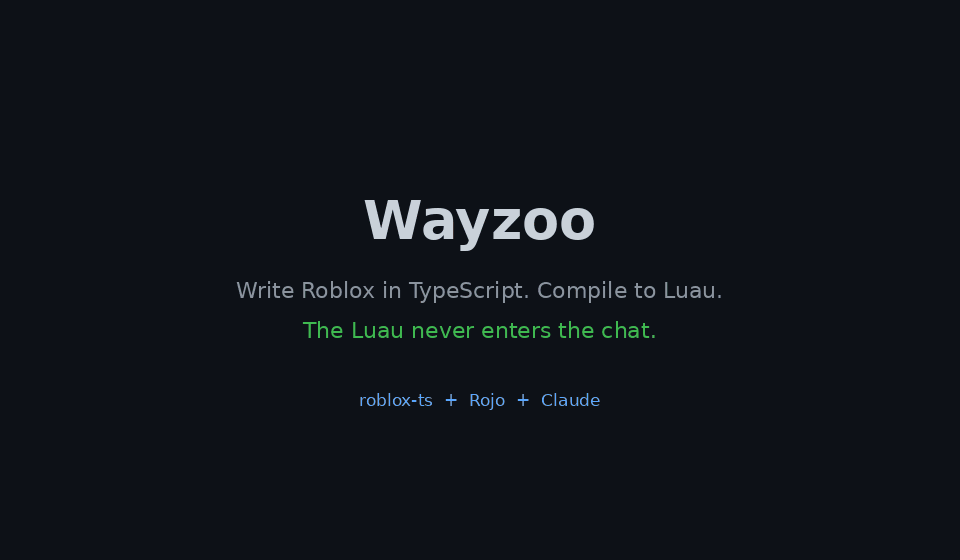

<h1 align="center">Wayzoo</h1>

<p align="center">
  <b>Write Roblox in TypeScript. Compile to Luau. Burn far fewer AI tokens.</b>
</p>

<p align="center">
  <a href="https://github.com/wayzoo/wayzoo-skill/stargazers"></a>
  <a href="https://github.com/wayzoo/wayzoo-skill/actions/workflows/ci.yml"></a>
  <a href="LICENSE"></a>
  
  
</p>

Wayzoo is a [Claude](https://claude.ai) skill plus a few small Node scripts. Claude writes the TypeScript once, [roblox-ts](https://roblox-ts.com) compiles it, and the Luau reaches Roblox Studio without the AI ever reading or retyping it. It runs natively on **Windows** (no WSL, no Bash), macOS and Linux.

   <p align="center">
     
   </p>

**Install in 1 minute (Claude web or desktop app, any OS):** download [`dist/wayzoo.skill`](dist/wayzoo.skill), then in Claude open **Customize > Skills**, click **+**, choose **Create skill > Upload a skill**, pick the file and switch the skill on. Then ask Claude to write your Roblox code in TypeScript. More options in [INSTALL.md](INSTALL.md).

---

## Contents

[The problem](#the-problem) · [How Wayzoo helps](#how-wayzoo-helps) · [Measured savings](#measured-savings) · [Install](#install) · [Commands](#commands) · [Roblox Studio and MCP](#roblox-studio-and-mcp) · [Repo layout](#repo-layout) · [FAQ](docs/faq.md) · [Contributing](#contributing)

## The problem

A naive AI + roblox-ts loop pays for the same code three times:

1. the AI writes the TypeScript,
2. it reads the compiled Luau back to check it,
3. it pastes that Luau into Studio.

Failed builds also dump a wall of compiler output into the chat. And the AI often guesses which `@rbxts` packages exist and invents import paths. On a big game this adds up fast.

## How Wayzoo helps

| Trick | Effect |
|---|---|
| `build` prints one line on success, only the first N lines on failure | Failed builds don't flood the context |
| Import errors (TS2307...) come first, with the faulty and expected path | Fewer hallucinated import paths |
| `deps` lists installed `@rbxts` packages in a few lines | The AI uses real packages, never reads `node_modules` |
| Compiled `.luau` is never printed or re-read | It is a build artifact, not something to review |
| Only changed files are reported and sent | No re-sending the whole project |
| Rojo live sync | Code reaches Studio without passing through the chat |
| Studio MCP used for live state only | Errors, instances, playtests, not source code |

More detail in [docs/how-it-works.md](docs/how-it-works.md).

## Measured savings

Run on a generated 12-function TypeScript file (about 3.3 KB, compiling to about 3.6 KB of Luau). Sizes are bytes of text; tokens scale roughly with that.

### Context used per build cycle (lower is better)

```text
Naive AI loop               [████████████████████████████████████████] 10.6 KB  baseline
Wayzoo + Roblox Studio MCP  [██████████████████████████              ]  7.0 KB  -34%
Wayzoo + Rojo sync          [█████████████                           ]  3.4 KB  -68%
```

The naive loop pays for the compiled Luau twice (read back, then pasted into Studio). With the Studio MCP, Wayzoo pushes each changed Luau file once and uses the MCP only for live telemetry. With Rojo, the Luau never enters the conversation at all: the AI gets one status line and Rojo syncs the rest.

### Benchmarks

| Scenario | Naive loop | Wayzoo strategy | Saving |
|---|---|---|---|
| **Code to Roblox Studio via Rojo** | ~10.6 KB | **~3.4 KB** (silent local compile, Rojo sync) | **about 68%** |
| **Code to Roblox Studio via MCP, no Rojo** | ~10.6 KB | **~7.0 KB** (changed Luau pushed once, MCP for telemetry only) | **about 34%** |
| TS compiler output with 25 type errors | ~3.4 KB | ~1.2 KB (truncated, import errors first) | about 65% |

**Best setup for Roblox Studio:** Rojo for code + Studio MCP for Output and playtests. That keeps the 68% saving on code and adds live debugging without paying for source again.

Reproduce it yourself (any OS):

```
node benchmarks/measure.mjs
```

> **Honest caveats.** One synthetic file, one machine. It covers the code-handling and build-output part of a session, not your whole conversation, and the naive baseline is an assumption of a typical loop. Please [share your own numbers](../../issues/new?template=token_report.md).

## Install

Everything needs only **Node.js 18+** ([nodejs.org](https://nodejs.org), or `winget install OpenJS.NodeJS.LTS` on Windows) and [Rojo](https://rojo.space) if you want live sync.

**1. Claude web or desktop app (Windows, macOS, Linux)**

1. Download `dist/wayzoo.skill` (or run `install.cmd` on Windows / `node install.mjs` anywhere to rebuild it).
2. In Claude: **Customize > Skills**, **+**, **Create skill > Upload a skill**, pick the file, turn the skill on.
3. Code execution / file creation must be enabled in your Claude settings.

**2. Claude Code**

```
node install.mjs --claude-code
```

Installs into `~/.claude/skills/wayzoo` (`%USERPROFILE%\.claude\skills\wayzoo` on Windows). Add `--project` to install for the current project only.

**3. Windows, no WSL, no Bash**

```
git clone https://github.com/wayzoo/wayzoo-skill.git
cd wayzoo-skill
install.cmd
.\wayzoo.cmd setup my-game
.\wayzoo.cmd build my-game
cd my-game
rojo serve
```

PowerShell users can run `.\install.ps1` instead (if scripts are blocked: `powershell -ExecutionPolicy Bypass -File .\install.ps1`).

**4. macOS / Linux, plain scripts**

```
git clone https://github.com/wayzoo/wayzoo-skill.git
cd wayzoo-skill
node skills/wayzoo/scripts/wayzoo.mjs setup my-game
node skills/wayzoo/scripts/wayzoo.mjs build my-game
cd my-game && rojo serve
```

The old `setup.sh` / `build.sh` still work as thin wrappers. Full details in [INSTALL.md](INSTALL.md).

## Commands

Run as `node skills/wayzoo/scripts/wayzoo.mjs <command>` (or `wayzoo.cmd <command>` on Windows).

| Command | What it does |
|---|---|
| `setup <dir>` | Creates a roblox-ts project: `src/server`, `src/client`, `src/shared` |
| `build <dir> [N]` | Compiles. One line on success, first N error lines on failure (default 25). Import errors first |
| `deps <dir>` | Lists installed `@rbxts` packages with version and types entry |
| `doctor [dir]` | Checks OS, Node, npm, Rojo, the project and its Rojo project file, and the Windows entry points |
| `rojo serve` | Syncs the compiled output into Studio |
| `node install.mjs` | Builds `dist/wayzoo.skill` and prints the Claude upload steps |
| `node tools/test.mjs` | Offline smoke tests |
| `node benchmarks/measure.mjs` | Reproduces the benchmark |

Example output:

```
OK build (1 file(s) changed): out/server/main.server.luau
```

```
ERR build failed: 1 import/resolution error(s) first, then others (first 25 lines):
HINT src/server/bad.ts: cannot resolve 'shared/missing' -> no file at src/shared/missing(.ts|/index.ts) (baseUrl=src)
HINT Rojo maps: out/shared, out/server, out/client
src/server/bad.ts:2:19 - error TS2307: Cannot find module 'shared/missing' or its corresponding type declarations.
...
```

## Roblox Studio and MCP

The TypeScript files in `src/` are the only source of truth. They are compiled silently by `wayzoo build` and synced by Rojo.

If you connect a Roblox Studio MCP, the skill uses it **only for real-time telemetry**: reading the Output window, inspecting instances during a playtest, starting and stopping playtests. It never reads compiled Luau back out of Studio and never edits synced scripts there (Rojo would overwrite them, and the TS would stay wrong). Studio errors that name a compiled script are mapped back to the matching `.ts` file.

`wayzoo doctor` checks that the project has a `default.project.json`, so Rojo sync is ready. MCP tool names differ between servers; reports on which servers you tried are welcome in an issue.

Details: [skills/wayzoo/references/mcp-studio.md](skills/wayzoo/references/mcp-studio.md).

## Repo layout

```
skills/wayzoo/        the Claude skill (SKILL.md, Node scripts, references)
dist/wayzoo.skill     ready-to-upload skill (built by node tools/pack.mjs)
install.mjs / .cmd / .ps1   installer (Claude web/desktop, Claude Code), Windows native
wayzoo.cmd            Windows launcher for the CLI
tools/                dependency-free zip packer and smoke tests
examples/hello-game/  tiny project to try it on
benchmarks/           reproducible token measurement
docs/                 how it works, FAQ
docs/community/       ready-to-post DevForum, Discord and Reddit announcements
.github/              issue templates, PR template, CI (Linux, Windows, macOS)
```

## Contributing

Issues and pull requests are welcome, see [CONTRIBUTING.md](CONTRIBUTING.md). The most useful things right now: real token numbers from your projects, reports on which Studio MCP servers work, and Windows feedback.

If Wayzoo saves you tokens, a star helps others find it.

## License

[MIT](LICENSE)
